# FarmLink AMIS — Agricultural Market Intelligence System

Which mandi (agricultural market) leaves a farmer with the most money after transport? FarmLink answers that question for a shipment, records the farmer’s choice, and lets buyers find available crop lots. It is a local Flask and SQLite software engineering project using illustrative prices and distances for **Indore, Dewas, and Ujjain**.

[Quickstart](#run-locally) · [Try a shipment](#walk-through-a-shipment) · [Coursework diagrams](#coursework-diagrams) · [Sequence diagram](#sequence-diagram) · [Requirements](#requirements-and-acceptance-criteria) · [Design](#design-and-implementation) · [Testing](#verification) · [Contributing](#contributing)

## Run locally

You need Python with pip and the standard-library `sqlite3` module. There is no separate database server, frontend build, or API key to configure. From the project directory, create a virtual environment to keep FarmLink’s dependencies separate from other Python projects:

```sh
python -m venv .venv
```

Activate it with `.venv\Scripts\Activate.ps1` (Windows PowerShell) or `source .venv/bin/activate` (macOS/Linux). Then install the dependencies and start the development server:

```sh
python -m pip install -r requirements.txt
python app.py
```

Open **http://127.0.0.1:5050**. You can explore the market desk, price history, and available lots without signing in. Stop the server with `Ctrl+C`; accounts and listings persist across restarts.

### Walk through a shipment

1. **Compare markets.** Register as a **Farmer**. On the market desk, select Indore, Wheat, and 500 kg, then choose **Update comparison**. Compare the gross, transport, and net columns. With the initial quotes, Indore has the highest net return even though Dewas offers the highest price per quintal.
2. **Record the choice.** Select **Save market choice**. Open **My decisions** to see the quantity and estimated return at the time you saved it. This creates a private journal entry; it does not advertise the crop.
3. **List the produce.** Open **Crop exchange** and publish a lot with its district, quantity, expected price per quintal, and grade. This is the record buyers can find. The asking price is entered by the farmer and can differ from the market quote.
4. **Check what a buyer sees.** Sign out and register as a **Buyer**. Filter the exchange by Wheat and Indore to find the listing. The exchange supports discovery; it does not take orders or process payments. When the produce is no longer available, the farmer can sign back in and close the lot.

## Software development life cycle

The coursework follows a shipment from requirements analysis (who needs which information) through design (how to compare markets and record a decision) to implementation and verification. A change to the freight rate, for example, affects the ranking calculation, the explanation on the market desk, and the expected returns in the workflow test.

### Coursework diagrams

These Mermaid diagrams adapt the AMIS PDFs for GitHub. Expand a view to see the diagram and its source page. They describe the **coursework design**; the [implementation notes](#design-and-implementation) describe the application you can run here.

<details open>
<summary><strong>Requirements: use cases and actors</strong></summary>

The farmer’s question connects several use cases: view market prices, compare markets, calculate transport cost, and get a recommendation. The boundary also shows which information the design expects from external services.

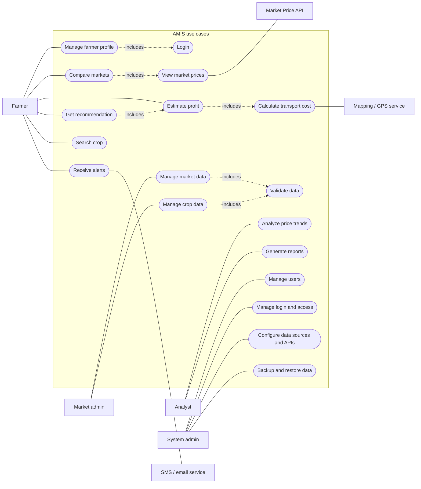

Source: `amis_use_case_v3.drawio.pdf`, p. 1. The alternate use-case drawing emphasizes the shorter path from crop search to a recommendation:

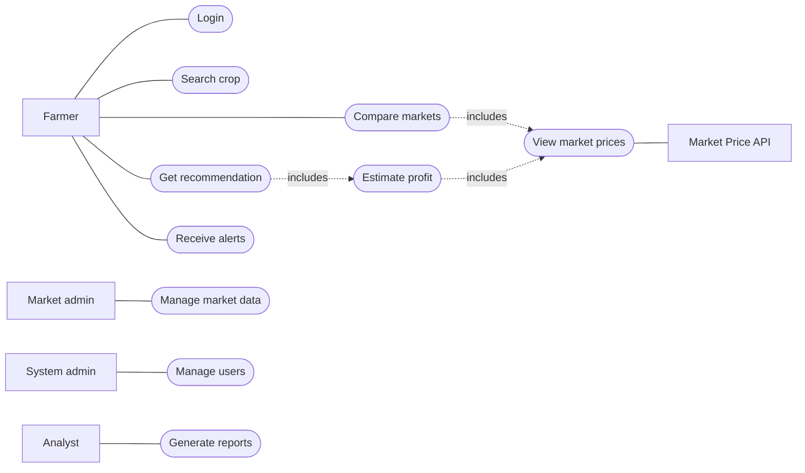

Source: `UML diagram.drawio (1).pdf`, p. 1.

</details>

<details>
<summary><strong>Experiment 3: context and level-1 data flow</strong></summary>

Level 0 treats AMIS as one process and identifies what crosses its boundary. Level 1 opens that process to show where profiles, crop listings, prices, recommendations, and reports are read or written.

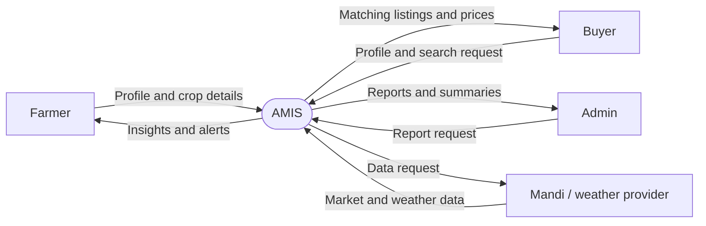

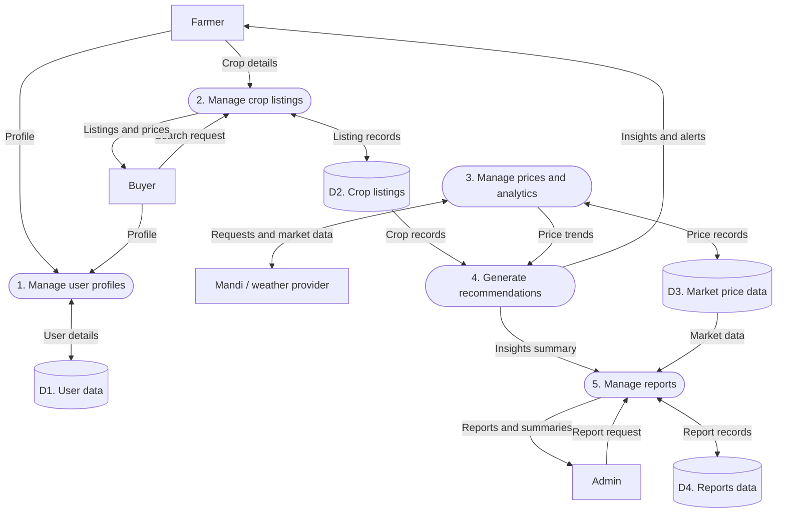

Source: `AMIS_Experiment_03_Data_Flow_Diagram.pdf`, pp. 3–4, respectively.

</details>

<details>
<summary><strong>Experiment 5: class and object diagrams</strong></summary>

The class diagram defines concepts such as `FarmerCrop`, `PriceRecord`, and `ReturnEstimate`. The object diagram gives those types concrete values for a farmer and shipment. These are domain models, not Python class declarations or SQLite table definitions.

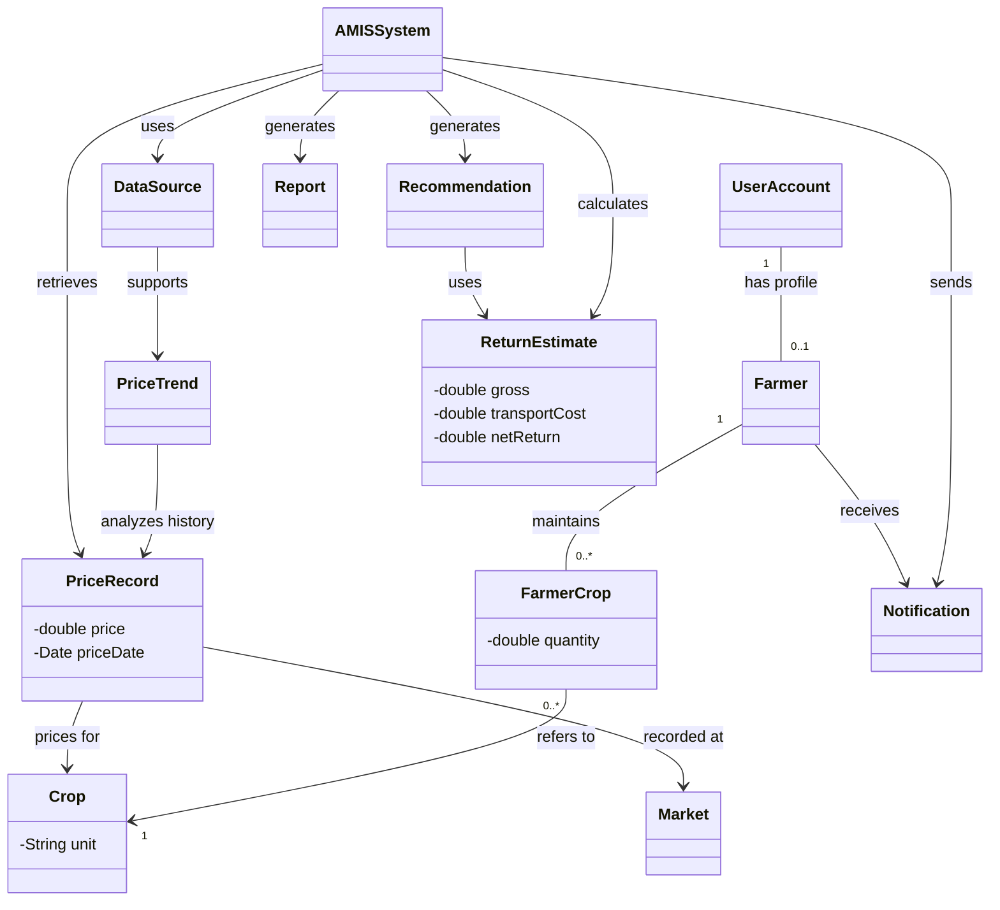

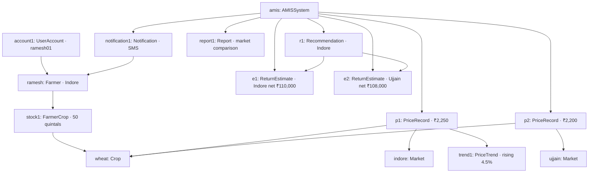

Source: `AMIS_Class_and_Object_Diagrams.drawio.pdf`, pp. 1–2, respectively.

</details>

<details>
<summary><strong>Experiment 6: crop-selling activity</strong></summary>

Follow the decision diamonds to see what changes when login fails, the farmer skips comparison, a price changes significantly, or the recommendation is declined.

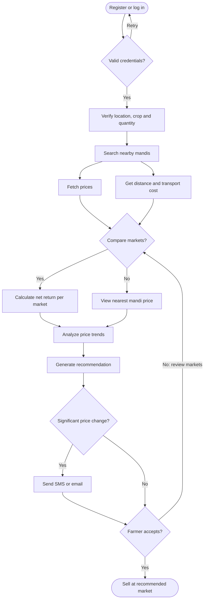

Source: `amis_activity_diagram.drawio.pdf`, p. 1. The worked wheat-shipment variant below appears in `Software_Engineering_Experiment_06_AMIS.pdf`, p. 5. That example recommends Dewas; the local seed data and freight rule instead [rank Indore first](#decision-rule-why-the-highest-quote-can-lose).

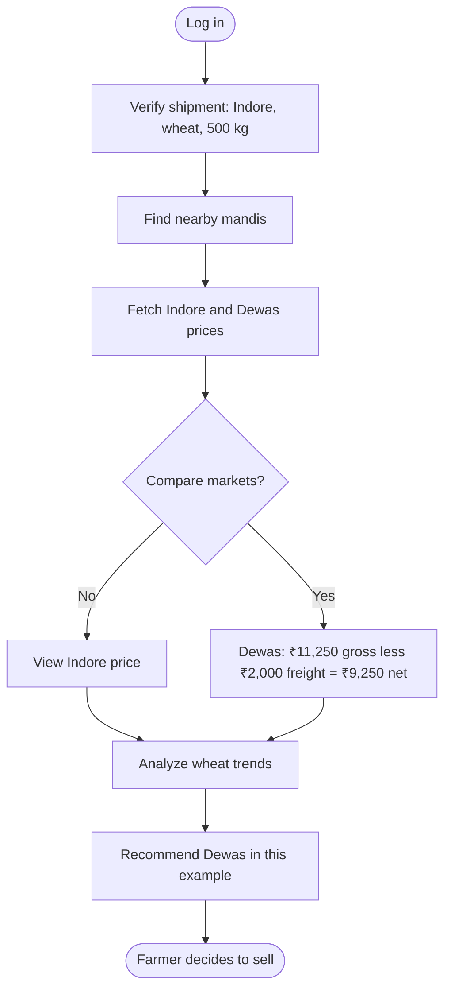

</details>

#### Sequence diagram

Read from top to bottom for the order of messages: authenticate the farmer, request market data, calculate returns, show a recommendation, then save the confirmed decision. The external market API is a participant in the design; the local app reads stored quotes.

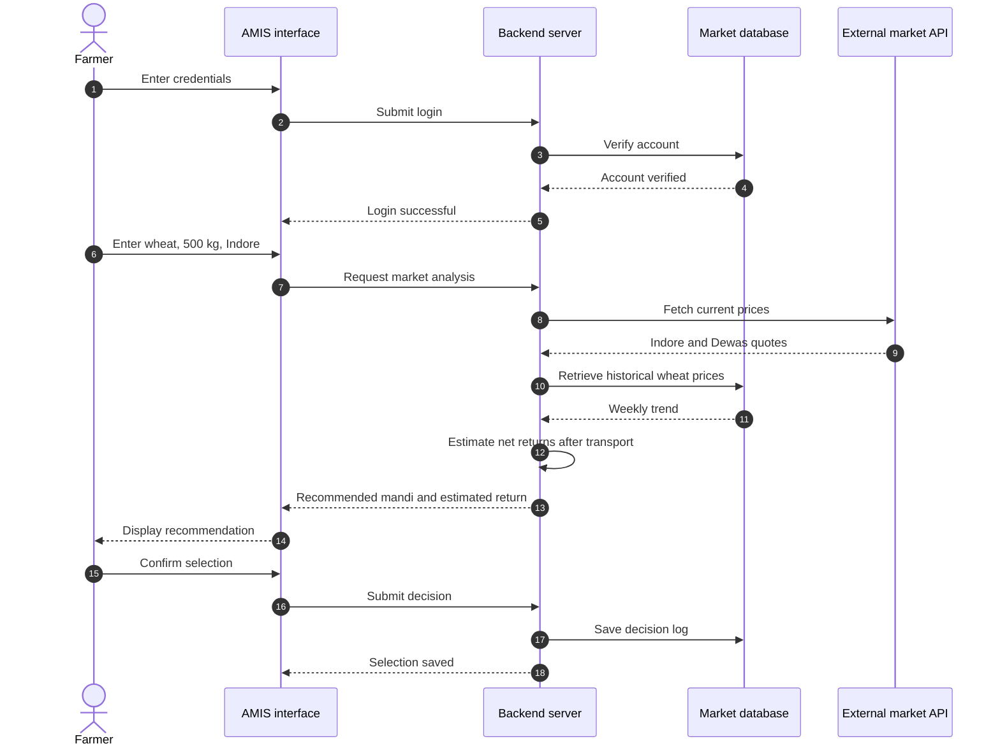

Source: Experiment 7, `Experiment_07_AMIS_Sequence_Diagram_Reference_Format.pdf`, p. 3, fig. 1.

<details>
<summary><strong>Experiments 8 and 9: components and deployment</strong></summary>

The component view groups the portals, application services, and data sources by responsibility. The deployment view shows how clients and servers would communicate in the proposed distributed system. To run this repository you only need one local Flask process and SQLite.

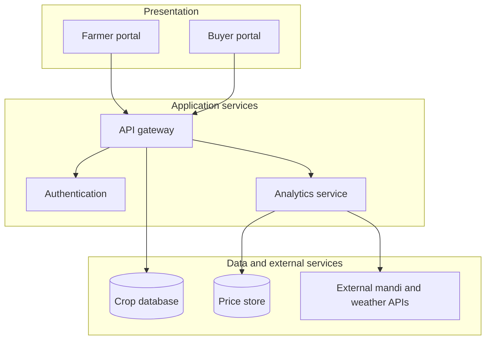

Source: `exp 8 SE.pdf`, p. 1.

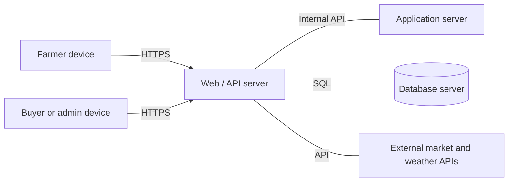

Source: `Exp 9 SE.pdf`, p. 1.

</details>

### Requirements and acceptance criteria

| Coursework baseline | User requirement | Observable acceptance criterion |
| --- | --- | --- |
| Exp 5 / 6: decision support | A farmer compares a crop and quantity from a starting district. | `/` ranks markets by estimated net return, offers a nearest-only view, and flags weekly price changes of at least 5% in either direction. |
| Exp 7: decision journal | A farmer keeps a record of a market choice. | Confirming a market adds the crop, quantity, market, estimated net return, and timestamp to that farmer’s `/journal`. |
| Exp 3 / 8: crop exchange | A farmer lists produce; a buyer finds it. | `/lots` shows an available lot when its crop and district match. Its owner can close it to remove it from other users’ results. |
| Exp 3 / 8: reporting | Staff review decisions and maintain reference quotes. | Analysts and admins can see totals by crop and market in `/reports`; only admins can edit quotes. |
| SRS §3.1, items 3, 4, 6: price records | A visitor inspects prices for a crop at a selected mandi. | `/prices` shows dated observations and relative price bars, with an optional date filter. |
| Exp 9 / 10: delivery and testing | The system runs locally and its main workflow is reproducible. | Starting the app initializes SQLite; the workflow test runs against a separate temporary database. |

## Design and implementation

FarmLink serves HTML from a single Flask application. For example, saving a market choice sends a form to `POST /confirm`: the server identifies the signed-in farmer, recalculates the return using the stored shipment and current quote, writes the decision to SQLite, and redirects to `/journal`. The browser submits the market name rather than a final amount to store.

### Where to make changes

| File | Responsibility |
| --- | --- |
| [app.py](app.py) | Flask routes, role checks, comparison rules, SQLite schema and seed data, and the staff CLI command. Start with `comparison()` for ranking changes. |
| [templates/site.html](templates/site.html) | Jinja template for the market desk, journal, exchange, price history, and staff reports. The route selects the view and passes its data to the template. |
| [static/site.css](static/site.css) | Shared styles for forms, market comparisons, and listings. |
| [requirements.txt](requirements.txt) | Supported Flask dependency range used by the installation command. |
| [test_workflow.py](test_workflow.py) | Integration test that exercises the routes with a temporary database. |

Public registration creates farmer or buyer accounts; privileged accounts are provisioned locally. Passwords are hashed, and POST forms require a session CSRF token. Access is checked on the server: hiding the **Reports** link from a buyer is a navigation choice; the role check on `/reports` is what prevents access.

### Decision rule: why the highest quote can lose

For **500 kg of wheat from Indore** (5 quintals), the initial quotes give these results. Freight is ₹50 per kilometre **per shipment**.

| Destination | Quote (₹/quintal) | Gross (₹) | Freight (₹) | Net (₹) |
| --- | ---: | ---: | ---: | ---: |
| Indore | 2,100 | 10,500 | 5 km × 50 = 250 | **10,250** |
| Dewas | 2,250 | 11,250 | 40 km × 50 = 2,000 | 9,250 |
| Ujjain | 2,200 | 11,000 | 55 km × 50 = 2,750 | 8,250 |

Dewas pays ₹750 more than Indore before transport, but costs ₹1,750 more to reach. The app therefore ranks Indore first. It sorts by **gross minus freight**, breaking ties by shorter distance. The weekly trend is a separate signal, not a price forecast.

### Data model

In SQLite, `decisions.owner` and `lots.owner` identify a user, without declared SQL foreign keys. Each quote is keyed by market and crop; history adds the observation date to that key. Updating a quote writes the current and prior-week observations through a SQLite trigger. A saved decision retains its estimated return even if prices later change. Publishing a lot is independent of saving a decision.

## Verification

Run the integration test from the project directory:

```sh
python -m unittest -v
```

[test_workflow.py](test_workflow.py) uses Flask’s test client and sets `AMIS_DATA` to a temporary directory. It registers a farmer, checks the two leading net-return amounts in the example above, confirms a choice, publishes a lot, then signs in a newly registered buyer. It checks both matching and nonmatching crop searches and verifies that the buyer receives HTTP 403 on `/reports`.

**Manual acceptance check for price history:** Create an admin account, update a market’s current and previous-week quotes in `/reports`, then open `/prices` for that crop and market. Check both dated values and filter by one date. This path is implemented but is outside the automated workflow test.

## Local operation and maintenance

- **Storage:** The default data directory is `instance/`. The app creates `market.sqlite` and `session.key` if missing. Set `AMIS_DATA` before starting the server or running staff commands to use another directory.
- **Staff provisioning:** Run `python -m flask --app app staff analyst1 Analyst` or `python -m flask --app app staff admin1 Admin`. Each command prompts for a password.
- **Scope:** The catalog covers wheat, soybean, and maize. Distances are fixed; prices are sample or admin-maintained. There are no live mapping, weather, or market feeds, and alerts appear only in the app.
- **Next work:** Extend tests to cover quote updates and lot closure. Catalog and account administration, regional localization, backup and recovery, and production security and performance validation remain open. The documented deployment is local.

### Troubleshooting

| Symptom | What to check |
| --- | --- |
| Python cannot import Flask. | Activate the virtual environment in the current terminal and rerun `python -m pip install -r requirements.txt` with the same Python used to start the app. |
| The desk shows different amounts from the example. | Check the shipment’s crop, district, and weight, then look at the current quotes. Admin edits persist. For a fresh demo without deleting existing records, set `AMIS_DATA` to a new empty directory and restart. |
| A staff account cannot sign in after creation. | Run the staff command with the same `AMIS_DATA` setting as the server. Each data directory has its own users and session key. |

## Contributing

For a bug report, include the account role, page, steps to reproduce, and expected and actual results. For a ranking issue, include the shipment and quotes: a difference in freight or price can change the result without any code change.

For a code change, identify the affected [acceptance criterion](#requirements-and-acceptance-criteria), update the relevant route or view, and run `python -m unittest -v` before submitting it. Add a regression test for changed behavior and describe any manual checks in the change summary. Keep local databases, session keys, and virtual environments out of contributions.

**License:** This project currently includes no license file. Contact the project owner for reuse or redistribution terms.
